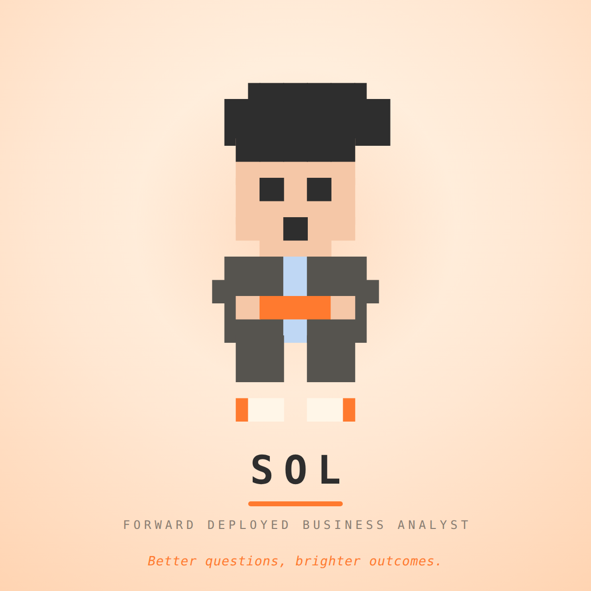

# SOL — Forward Deployed Business Analyst

An animated mascot for **SOL**, built entirely from Unicode **Block Elements**
(`U+2580–U+259F`) and exported as **PNG · GIF · MP4**.



> *"Better questions, brighter outcomes."*

| Asset | File |
|---|---|
| Hero still | [`assets/sol.png`](assets/sol.png) |
| Animated loop | [`assets/sol.gif`](assets/sol.gif) |
| Video (web/slides/social) | [`assets/sol.mp4`](assets/sol.mp4) |
| Source | [`mascots/sol.html`](mascots/sol.html) |
| Character sheet this is drawn from | [`reference/sol-character-sheet.png`](reference/sol-character-sheet.png) |

---

## The character

**Concept.** A young forward-deployed business analyst who sits *with* the
business, asks the better question, and turns it into impact.

**Soul.** SOL is the sunrise in the room — curious, optimistic, action-oriented.
Everything about the design serves one idea: *insight arriving*.

**Silhouette.** Deliberately not a limbed robot and not an orb. SOL is a human
figure whose signature is:

- a **hair mass wider than the head**, with the swoop leaning right,
- a **sky-blue shirt strip** inside a grey suit,
- a **tablet held in both hands** at chest height,
- **sneakers with a SOL-orange outer accent**.

**Palette** — straight from the character sheet:

| Swatch | Name | Hex |
|---|---|---|
| 🟧 | SOL Orange | `#FF7A2F` |
| ⬛ | Charcoal | `#2E2E2E` |
| 🟦 | Sky Blue | `#BFD7F4` |
| ⬜ | Cream | `#FFF6E8` |
| 🟫 | Skin | `#F5C7A7` |

Suit grey `#56544F` is derived from Charcoal so the hair still reads against the
jacket — at this scale a charcoal suit under charcoal hair collapses into one
blob.

---

## How it animates

SOL emotes through **eyes** plus an **insight spark** above the head, and the
loop is the analyst's actual job:

```
idle → blink → read the tablet → focus → ! → INSIGHT → share it → back to work
```

| State | What changes |
|---|---|
| `open` / `blink` | resting eyes, squint shut |
| `left` | glancing down at the tablet (reading) |
| `right` | glancing back at you (sharing) |
| `wide` + `open` mouth | the idea landing |
| tablet `dim` → `bright` | the screen lights up while reading |
| spark `small → mid → big` | the insight firing above the head |

The sequence sums to exactly **5200 ms**, which is why it is rendered with
`--duration 5200` — the last frame meets the first, so the GIF and MP4 loop with
no visible jump. At `--fps 15` that is exactly 78 frames.

---

## The technique: three stacked grids

A single character grid can only hold **one colour per cell**, which makes a
face impossible: the fringe and the eyes want to live in the same row, and an
eye wants to sit inside a skin-coloured cell.

So `mascots/sol.html` stacks three grids in the same monospace cell box:

| Layer | Carries |
|---|---|
| `#base` | the solid silhouette — where hair, skin, suit, shirt and shoes are |
| `#hair` | the fringe that overhangs the forehead |
| `#feat` | eyes, mouth, tablet, sneaker accents and the spark, drawn on top |

Half- and quarter-blocks (`▀ ▄ ▖ ▗ ▘ ▝`) then place a feature in the *upper* or
*lower* half of a cell, which is what gives the face its proportions: fringe →
skin → eyes → skin → mouth → chin.

Each row is written as a `[glyphs, mask]` pair of equal length, one mask letter
per glyph (`h` hair, `s` skin, `e` eye, `j` suit, `b` shirt, `o` orange,
`c` cream, `*` spark, `!` lit screen). Runs of the same mask letter are grouped
into a single `<span>`, so columns stay aligned.

---

## Rendering

```bash
npm install                                  # playwright
npx playwright install chromium              # skip if chromium is already present
# ffmpeg must be on PATH for gif/mp4

npm run build                                # validate the grid, then render all three
```

Or drive the renderer directly:

```bash
node scripts/render.mjs \
  --input mascots/sol.html --name sol --out assets \
  --selector .stage --width 600 --height 600 \
  --fps 15 --duration 5200 --scale 2 --hero 12 \
  --formats png,gif,mp4
```

`scripts/check-grid.mjs` is a guard worth running before every render: it fails
if any row's glyphs and mask are different lengths, if a row is the wrong width,
or if a non-Block-Element character crept in (geometric shapes like `◢◣◤◥` look
fine in a sketch but render with visible seams).

```bash
node scripts/check-grid.mjs mascots/sol.html
# ✓ 25 rows, 11 columns, Block Elements only
```

---

## Editing SOL

Everything lives in `mascots/sol.html`:

- **`BASE`** — the silhouette. Change the body here.
- **`eyes` / `mouths` / `sparks` / `tablet`** — the expression parts.
- **`sequence`** — the timed loop. If you change any `ms`, re-sum them and pass
  the new total as `--duration`, or the loop will jump.
- The palette is the `#mascot .hair { … }` block of CSS class colours.

---

## Credits

The render engine (`scripts/render.mjs`) is from the MIT-licensed
[mascot-maker](https://github.com/ahkamboh/mascot-maker) skill by Ali Hamza
Kamboh (@ahkamboh); its licence is kept at
[`reference/mascot-maker-LICENSE`](reference/mascot-maker-LICENSE). SOL's
design, grid, animation and the grid validator are original to this repo.
