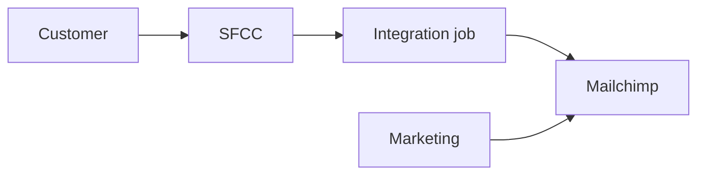

# Bài 03 — Project, stakeholder, scope

**Module:** 3. Project
**Progression:** Context. Stakeholder và scope thuộc context, trước requirement.
**Template luyện:** [`templates/00-context-package.md`](../templates/00-context-package.md) — Stakeholders, Systems Involved, Out of Scope, Decisions Made So Far
**ID:** `CTX-`

## Mục tiêu

Bạn phân biệt được project với operations, lập được stakeholder rộng hơn người trả tiền, và chặn scope creep bằng change request có time, cost, risk.

## Project và operations

**Project** là tạm thời và độc nhất: có điểm bắt đầu, điểm kết thúc, và một kết quả chưa được giao đúng theo cách này. **Operations** là việc lặp để giữ sản phẩm đang sống.

Một project có thể kết thúc trong khi **product** tiếp tục sống. Dự án sửa sync newsletter kết thúc khi lỗi được validate. SFCC và Mailchimp vẫn chạy ngày hôm sau. Requirement không được viết như thể sản phẩm biến mất lúc project đóng. Project cũng không được giữ mở chỉ vì operations còn việc hàng ngày.

## BA plan không phải PM plan

| | BA plan | PM plan |
|---|---|---|
| Câu hỏi | Làm sao tìm, ghi, trace, và đạt agreement về nhu cầu? | Làm sao giao đúng hạn, đúng ngân sách, đúng nguồn lực? |
| Bên trong | Cách elicitation, ai validate fact nào, chu kỳ review requirement, quy tắc traceability | Lịch, chi phí, người, rủi ro tiến độ, báo cáo |
| Không gánh thay | Lịch của cả dự án | Nội dung business rule |

Đọc PM plan để biết ràng buộc thời gian. Đừng sao chép PM plan rồi gọi đó là BA plan. PM không thay bạn quyết định requirement nào là fact.

## Stakeholder không chỉ là người trả tiền

Người trả tiền (sponsor, hoặc bên ký hợp đồng) có quyền. Họ không phải người duy nhất chịu hệ quả. Với một thay đổi phần mềm, xét ít nhất:

- **user** — người làm việc trên flow mới,
- **ops** — người gánh khi flow gãy ngoài giờ hành chính,
- **legal** — người chịu chữ trong contract và luật,
- **IT** — người sở hữu hệ thống, dữ liệu, và tích hợp.

Case Mailchimp: Marketing báo lỗi và sở hữu list. E-commerce Ops sở hữu SFCC. Customer là subscriber. Engineering sở hữu integration. Thiếu một vai, "thành công" bị định nghĩa bởi người còn lại trong phòng.

Trong Context Package, cột **Can validate what?** là bắt buộc. Stakeholder không validate được một fact thì không phải nguồn của fact đó. Mong muốn của họ đi vào assumption hoặc open question cho đến khi đúng người xác nhận.

## Power/Interest

Xếp từng stakeholder, không xếp cả phòng ban cho có:

| | Interest thấp | Interest cao |
|---|---|---|
| Power cao | **Keep Satisfied** | **Manage Closely** |
| Power thấp | **Monitor** | **Keep Informed** |

- **Manage Closely** — cùng họ ra agreement. Im lặng của nhóm này là rủi ro.
- **Keep Satisfied** — họ có thể dừng việc. Họ cần biết quyết định nào đụng tới quyền của họ.
- **Keep Informed** — họ sống với hệ quả hàng ngày. Bỏ họ thì requirement đúng trên giấy và sai lúc vận hành.
- **Monitor** — đừng dùng hết buổi elicitation cho nhóm này. Kiểm lại khi scope đổi.

Ghi ô của từng người trong mục Stakeholders của bản copy (thêm cột, hoặc ghi trong Interest). Không sửa file template gốc.

## Scope

Ba thứ cần có trước khi nhận việc mới:

- **Scope in** và **scope out**. In là việc case này chịu. Out nằm ở Out of Scope của `CTX-`. Một việc chưa được nhắc tới chưa phải out of scope. Out of scope là một câu đã viết.
- **Context diagram** — một hộp cho hệ thống đang xét, actor và hệ thống bên ngoài, dòng sự kiện hoặc dữ liệu đi qua biên. Không vẽ bên trong hộp. Systems Involved là bảng đi kèm. Nếu biên đang gây tranh cãi, bảng không thay diagram.
- **Scope statement** — một đoạn: làm gì, cho ai, kết quả nào, và điều gì nằm ngoài. Đoạn này khớp với Out of Scope. Hai chỗ mâu thuẫn thì đó là conflict, chưa phải requirement.

Ví dụ biên của case mẫu, đủ để thấy hộp và phía ngoài hộp:

## Scope creep và change request

**Scope creep** là việc mới đi vào sau khi scope đã có agreement, không qua một cửa nào. Cửa đó là **change request**. Request thiếu một trong ba thứ thì chưa phải request: **time**, **cost**, **risk**.

"Thêm cũng nhanh" không phải estimate. Ghi tác động lên thời gian, chi phí, và rủi ro, gồm rủi ro requirement: rule nào đổi, AC nào mất hiệu lực. Decision chấp nhận hoặc từ chối nằm ở Decisions Made So Far, có người quyết và ngày. Trước decision, việc mới là open question. Nó chưa nằm trong BRD.

## Thực hành

Làm trên cùng `CTX-` của bài 01. Đừng mở context thứ hai cho cùng một case.

1. Liệt kê stakeholder: user, ops, legal, IT, và người trả tiền nếu khác các vai đó. Mỗi dòng có Can validate what?
2. Gắn một ô Power/Interest cho mỗi người, với một fact hoặc assumption giải thích ô đó.
3. Viết scope statement ngắn và mục Out of Scope. Hai phần không mâu thuẫn.
4. Vẽ context diagram: hệ thống trong scope, hệ thống ngoài biên.
5. Lấy một việc ai đó vừa thêm. Viết change request với time, cost, risk, hoặc ghi nó là out of scope. Chưa có decision thì không đưa vào `BR-`.

## Xong khi nào

- Bạn nói được project này kết thúc lúc nào, và product nào vẫn sống sau đó.
- Bạn viết được ba dòng phân biệt BA plan và PM plan cho đúng case này.
- Stakeholders gồm người vận hành và người chịu ràng buộc, không chỉ sponsor. Mỗi người có việc họ validate được.
- Power/Interest không để trống. Bốn nhãn không được gắn bằng cùng một lý do chung.
- Scope in, scope out, và context diagram cùng mô tả một biên. Scope statement không chứa solution.
- Việc mới ngoài agreement đều có change request (time, cost, risk) hoặc nằm trong Out of Scope.

## Traceability

Bài này vẫn ở `CTX-`. Scope out không được xuất hiện lại như `BR-`, `US-`, hay `AC-`. Story sau này đụng thứ đã out of scope thì matrix phải chỉ ra decision của change request.

## Tự kiểm

- Ai chịu lỗi khi flow gãy ngoài giờ, và họ đã được hỏi chưa?
- Việc vừa thêm đã có time, cost, và risk, hay mới có một câu trong chat?
