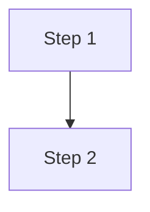

# Process Flow: FLOW-[XX] — [Title]

**Linked BRD:** `BR-` · **Linked Business Rules:** `RULE-`

## Trigger

What event starts this process?

## Actors

| Actor | Role in this flow |
|---|---|

## Preconditions

What must be true before this process can start?

## Current State (As-Is)

| Step | Actor | Action | System | Notes |
|---|---|---|---|---|
| 1 | | | | |

## Failure / Exception Points

Where does this process actually break or diverge from expected
behavior? This is usually where the real investigation lives.

| Step | Failure mode | Evidence | Linked open question (CTX-) |
|---|---|---|---|

## Target State (To-Be)

Only fill this in once the current-state investigation and business
rules are settled — don't design a fix before understanding the break.

| Step | Actor | Action | System | Linked rule (RULE-) |
|---|---|---|---|---|

## Postconditions

What must be true when this process completes successfully?

## Linked Artifacts

- User Stories: `US-`
- Business Rules: `RULE-`
